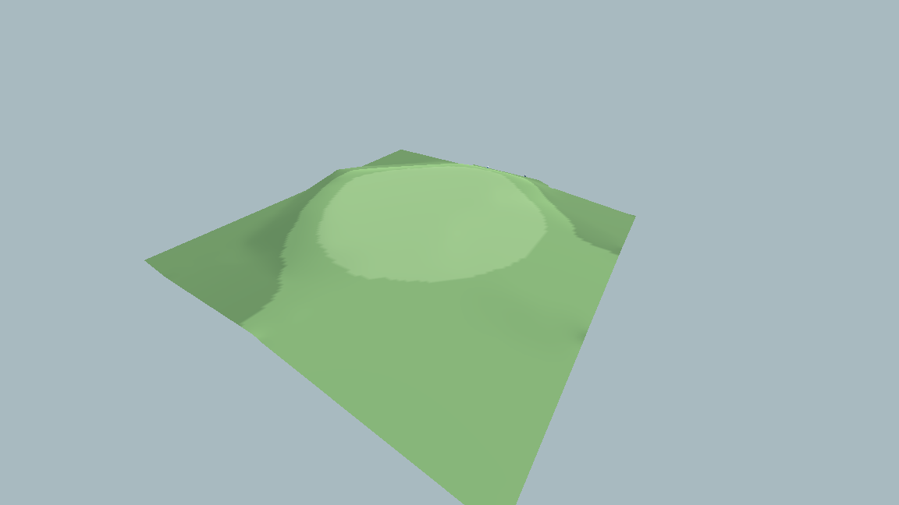
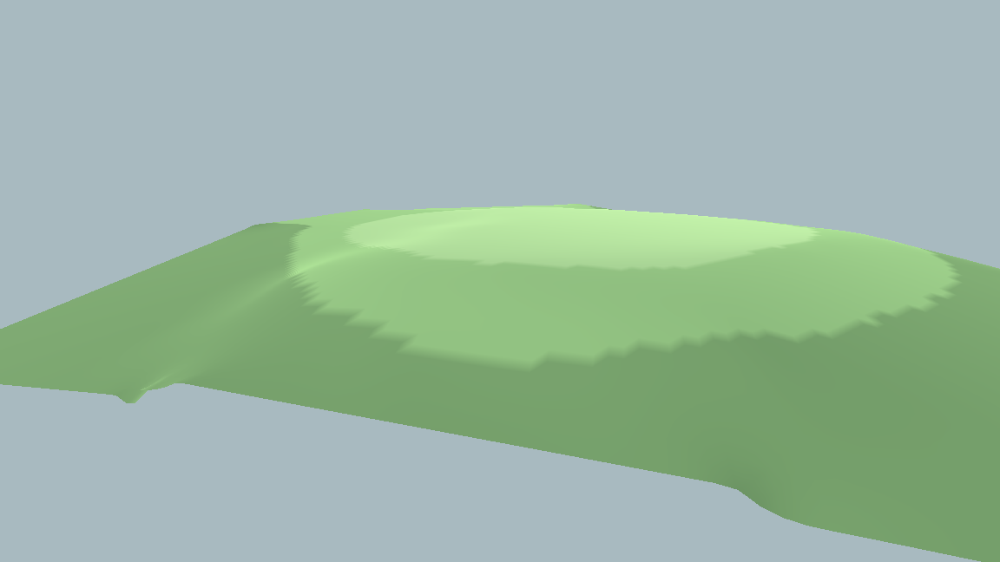
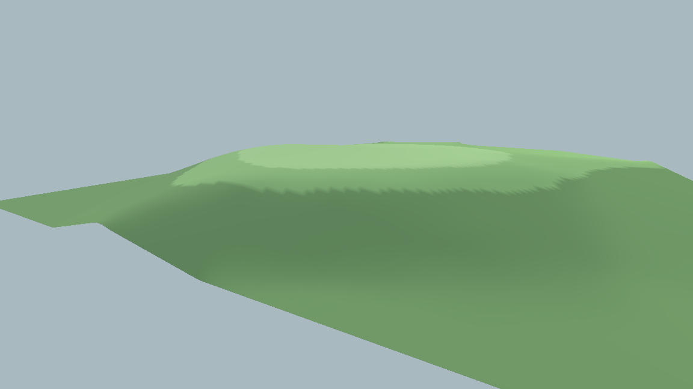

# Golf Diorama Sculptor

**An interactive 3D golf-course terrain sculpting prototype built in Godot 4 with GDScript.**

I started work on this project to prototype an early terrain editing tool to be used in a cozy golf hole diorama game I've come up with. The goal is to allow players to shape and mold a limited landscape to recreate their favorite hole or green complex into a scaled 3D model. 

**[Watch the terrain sculpting demonstration (MP4)](demo/terrain-demo.mp4)** — a short capture of the running prototype.

## What it does

- Terrain Generation - Using a grid-based ArrayMesh with vertices, triangle indices, UV's and basic hex colors.
- Terrain Sculpting -  Raise, lower, smooth and flatten the surface with mouse-controlled brushes. A slope tool also allows for the setting of start and end points, then creating a smooth slope with the brush.
- Paint Golf Surfaces - Using per-vertex colors, three simple shades of green, to represent the rough, fairway and green surfaces.
- Navigate in 3D - Orbit, pan and zoom around the terrain, with right mouse button, mouse wheel, and mouse wheel button. 
- Updating Terrain Geometry - Rebuild mesh data, recalculate vertex normals and refresh collision geometry after edits.

## Screenshots

## How it works

Procedural mesh

`terrain.gd` generates a 129 × 129 vertex grid across a 60-unit terrain area. Sculpting changes the Y coordinate of selected vertices rather than moving prebuilt 3D objects.

Mouse-driven editing

`sculpt_controller.gd` projects the cursor into the 3D scene with a physics raycast. The hit location becomes the center of the active brush. Radius, falloff and strength determine how nearby vertex heights change. The smoothing tool samples a snapshot of neighboring heights with a 3 × 3 neighborhood average, rather than repeatedly modifying values during the same pass. Flattening uses a captured target elevation. The slope tool interpolates between two chosen points.

Visuals and collision

After terrain deformation, the prototype rebuilds its mesh surface, accumulates and normalizes vertex normals for lighting, and regenerates concave collision geometry. This keeps the rendered terrain and the surface hit by later raycasts aligned.

Surface painting

Rough, fairway and green are represented using vertex colors. This is a simple, useful prototype technique, but the visible boundaries can appear jagged at the current mesh resolution. Smoother material blending is a planned improvement.

## Controls

| Input | Action |
|---|---|
| Left mouse drag | Sculpt or paint with the selected tool |
| `1` / `2` | Raise / Lower |
| `3` / `4` | Smooth / Flatten |
| `5` | Two-point slope tool |
| `R` | Reset slope points when using the slope tool |
| `G` / `F` / `T` | Paint Green / Fairway / Rough |
| Middle mouse drag | Orbit camera |
| Right mouse drag | Pan camera |
| Mouse wheel | Zoom |

Brush radius and strength are currently exposed as properties in the Godot editor, rather than through an in-game toolbar.

## Run it locally

1. Install **Godot 4**.
2. Clone this repository: `git clone https://github.com/asinclair-atx/golf-diorama.git`
3. Open `project.godot` in Godot's Project Manager.
4. Press **F5** to run the configured main scene (`main.tscn`).

The prototype uses no external asset downloads.

## Engineering lessons and next steps

One of the central challenges was keeping vertex positions, shading normals and physics collision synchronized while editing a mesh at runtime. The current approach regenerates the full mesh and collision shape after changes. That favors implementation clarity over performance; a future version could update only modified regions.

Next steps include smoother transitions between golf surface types, an in-game tool palette, more efficient terrain updates, and tools for shaping recognizable golf-hole features such as bunkers.

## About the project

I'm a computer science student and longtime golfer exploring the intersection of golf, software engineering, interactive 3D tools and simulation. This independent prototype is an opportunity to practice procedural geometry, vector mathematics, raycasting, and debugging real-time systems.

## Project status

Functional work-in-progress prototype. All screenshots and the demonstration show the project itself.
